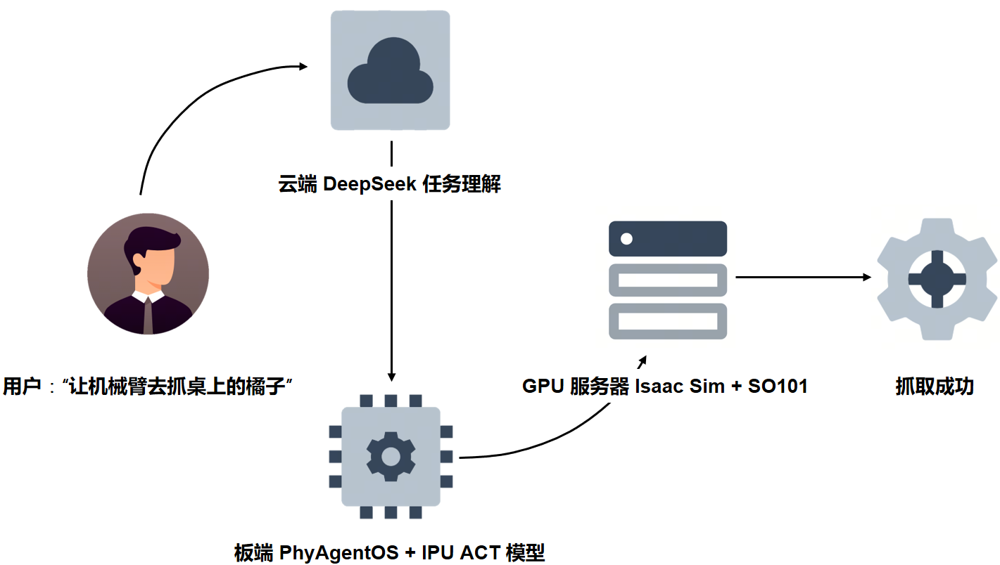
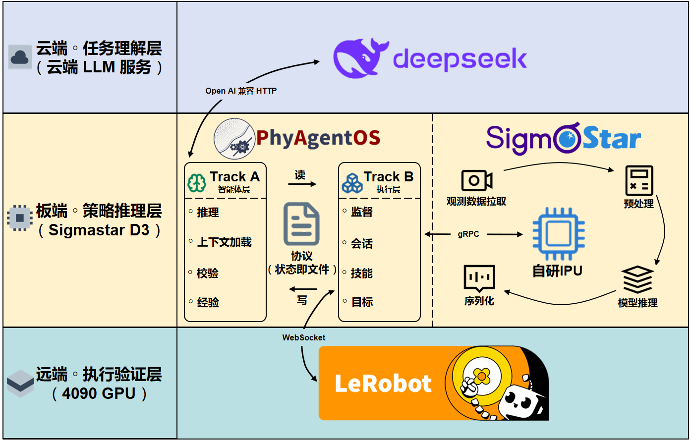

<div align="center">

<h1>PhyAgentOS × Sigmastar × SO101<br>云·边·端具身智能闭环实践</h1>

<h3>一句话自然语言指令 → 云端 LLM → 边缘 IPU 策略推理 → Isaac Sim 机械臂执行</h3>

<p>
  
  
  
  
</p>

<p>
  
  
  
  
</p>

</div>

---

## 🌟 这是什么

在一张 **Sigmastar 边缘板**上，让开源具身智能 OS **[PhyAgentOS](https://github.com/PhyAgentOS/PhyAgentOS)** 驱动 **SO101 机械臂**完成一次完整的「**抓橘子**」任务：

<div align="center">



<p><sub>▲ 一句话指令的端到端流转：云端任务理解 → 板端策略推理 → 远端仿真执行</sub></p>

</div>

把云端大模型、IPU 边缘推理、Isaac Sim 仿真三套异构组件串成一条可复现的工程链路，就是本项目要解决的核心问题。

---

## ✨ 核心亮点

<table>
<tr>
  <td width="44" align="center">☁️</td>
  <td width="180"><b>云·边·端三端解耦</b></td>
  <td>任务理解（云）· 策略推理（边）· 执行验证（远端）独立演进，任一端升级不影响其他端</td>
</tr>
<tr>
  <td align="center">⚡</td>
  <td><b>IPU 边缘加速</b></td>
  <td>ACT 策略经工具链量化部署到板端 IPU，视觉数据不出边缘节点，兼顾隐私与延迟</td>
</tr>
<tr>
  <td align="center">🧩</td>
  <td><b>标准化协议栈</b></td>
  <td>OpenAI 兼容 HTTP · gRPC · TargetWS（WebSocket+msgpack）—— 业界主流协议，零厂商锁定</td>
</tr>
<tr>
  <td align="center">🔄</td>
  <td><b>模型即插即用</b></td>
  <td>LLM 端任意 OpenAI 兼容模型（DeepSeek / Qwen / GPT）可无缝替换；策略端 ACT → SmolVLA 等可切换</td>
</tr>
<tr>
  <td align="center">📐</td>
  <td><b>文件即状态机</b></td>
  <td>LLM 与 watchdog 通过 <code>SESSIONS.md</code> 文件协议通信，<code>pending → running → success</code> 全程可追溯</td>
</tr>
<tr>
  <td align="center">🔬</td>
  <td><b>开箱即用的双 venv</b></td>
  <td>板端 PhyAgentOS（py3.11）与 IPU 策略服务器（py3.10）通过 gRPC 板内通信，依赖零冲突</td>
</tr>
</table>

---

## 🏗️ 系统架构

<div align="center">



<p><sub>▲ 三端协同架构：云端·任务理解层 · 板端·策略推理层 · 远端·执行验证层</sub></p>

</div>

### 三端分工

| 端 | 角色 | 运行内容 | 关键协议 |
|:---|:-----|:---------|:---------|
| ☁️ **云端** | 任务理解 | DeepSeek（或任意 OpenAI 兼容 LLM） | OpenAI HTTP |
| 📦 **板端（Sigmastar）** | 策略推理 + 调度 | PhyAgentOS（paos_venv, py3.11）<br>IPU 策略服务器（lerobot_venv, py3.10） | LeRobot async gRPC |
| 🖥️ **远端（4090 GPU）** | 执行验证 | Isaac Sim 5.1 + Isaac Lab 2.3 + SO101 + `so101_server.py`<br>（leisaac conda, py3.11） | TargetWS（WebSocket + msgpack） |

#### 板端内部双轨

PhyAgentOS 在板端以**双轨结构**组织运行时：

| 轨 | 名称 | 职责 |
|:---|:-----|:-----|
| 🧠 **Track A** | 推理 | 上下文理解 · 检验 · 经验 |
| ⚙️ **Track B** | 执行 | 协议（状态/数据交互）· 会话 · 接触 · 目标 |

板端 IPU 侧维持一个**持续运转的推理回路**：不断从目标端拉取 `front` / `wrist` 两路视觉数据，完成预处理后喂入自研 IPU，由 ACT 模型输出 action chunk。整个过程以 30Hz 持续运行，不依赖外部触发。

Track B 的「协议」子项作为 IPU 回路的对外接口，通过 **gRPC** 把每次推理产出的 action chunk 回流到执行链路。

---

## 🔄 一次任务的端到端流程

<table>
<tr>
  <td width="36" align="center"><b>1</b></td>
  <td><b>用户输入</b><br><sub>在 <code>paos agent</code> 交互界面输入：「让机械臂去抓桌子上的橘子」</sub></td>
</tr>
<tr>
  <td align="center"><b>2</b></td>
  <td><b>LLM 任务理解</b><br><sub>云端 LLM 通过 OpenAI 兼容协议返回 <code>write_file</code> 工具调用，向 <code>SESSIONS.md</code> 写入 <code>status: pending</code> 的 session</sub></td>
</tr>
<tr>
  <td align="center"><b>3</b></td>
  <td><b>watchdog 调度</b><br><sub>板端 watchdog 轮询 <code>SESSIONS.md</code>，claim 待执行 session，状态迁移 <code>pending → running</code></sub></td>
</tr>
<tr>
  <td align="center"><b>4</b></td>
  <td><b>观测拉取</b><br><sub>watchdog 通过 TargetWS 拉取 <code>front</code> 图 / <code>wrist</code> 图 / 6 维关节状态</sub></td>
</tr>
<tr>
  <td align="center"><b>5</b></td>
  <td><b>IPU 策略推理</b><br><sub>通过 gRPC 调板端 IPU ACT，返回 <code>[T, 6]</code> action chunk</sub></td>
</tr>
<tr>
  <td align="center"><b>6</b></td>
  <td><b>动作下发</b><br><sub>通过 TargetWS 下发 action chunk 到 Isaac Sim，机械臂逐步执行</sub></td>
</tr>
<tr>
  <td align="center"><b>7</b></td>
  <td><b>循环反馈</b><br><sub>循环 4-6，直到 <code>success</code> / <code>max_steps</code> / <code>timeout</code>，最终结果写入 <code>SESSIONS.md</code></sub></td>
</tr>
</table>

---

## 🧱 关键模块

<table>
<tr>
  <td><b>层</b></td>
  <td><b>组件</b></td>
  <td><b>职责</b></td>
</tr>
<tr>
  <td rowspan="2">📥 <b>策略接入</b></td>
  <td><code>IPUACTPolicyClient</code></td>
  <td>gRPC 客户端，自包含 protobuf descriptor + pickle shim，<b>无需服务端安装 PhyAgentOS</b></td>
</tr>
<tr>
  <td><code>serve_ipu_async</code></td>
  <td>板端 IPU 策略服务器，加载 ACT <code>.img</code>，常驻等待推理请求</td>
</tr>
<tr>
  <td rowspan="2">🔌 <b>Adapter 层</b></td>
  <td><code>ACTPolicyAdapter</code></td>
  <td>策略 adapter，把 IPU 输出的 action chunk 转成 target 可下发的格式</td>
</tr>
<tr>
  <td><code>SO101TargetAdapter</code></td>
  <td>Target adapter，对接 Isaac Sim 观测格式（<code>policy.joint_pos</code> / <code>policy.front</code> / <code>policy.wrist</code>）</td>
</tr>
<tr>
  <td rowspan="2">⚙️ <b>调度层</b></td>
  <td><code>IPUACTSkillRuntime</code></td>
  <td>SO101 + IPU ACT 专属 skill runtime，驱动 observe → adapter → infer → action_chunk 主循环</td>
</tr>
<tr>
  <td><code>SO101IsaacRemoteTargetProxy</code></td>
  <td>板端 target proxy，注入 SO101 默认参数 + action 校验</td>
</tr>
<tr>
  <td>🖥️ <b>执行端</b></td>
  <td><code>so101_server.py</code></td>
  <td>GPU 服务器侧 TargetWS server，承载 Isaac Sim 仿真。<b>独立进程，不依赖 PhyAgentOS 包</b></td>
</tr>
<tr>
  <td>📝 <b>通信协议</b></td>
  <td><code>SESSIONS.md</code></td>
  <td>LLM 与 watchdog 之间的<b>唯一通信媒介</b>，YAML 格式，文件即状态机</td>
</tr>
</table>

---

## 📋 协议文件矩阵

PhyAgentOS 用一套 Markdown + YAML 的**文件协议矩阵**驱动整个调度链路：

| 文件 | 角色 | 说明 |
|:-----|:-----|:-----|
| `TARGETS.md` | target 注册表 | 声明 `so101_isaac` target（endpoint、adapter、config） |
| `SKILLRUNTIME.md` | skill runtime 注册表 | 声明 `act_ipu_so101`（policy client、adapter、checkpoint 路径） |
| `SESSIONS.md` | 任务队列 / 状态机 | LLM 写入 → watchdog 轮询，状态迁移 `pending → running → success / failed` |
| `so101_isaac.runtime.yaml` | 运行时契约 | `so101_joint_pos_v1` action contract（30Hz、6-DoF、chunk=100/16） |

---

## 🗂️ 项目结构

```
output/
│
├── README_zh.md                          # 本文档
│
├── PhyAgentOS/                           # PhyAgentOS 完整源码
│   ├── agent/                            #   Track A  ─  Planner / Critic / Memory
│   ├── runtime/                          #   Track B  ─  执行平面
│   │   ├── watchdog/                     #     WatchdogSupervisor
│   │   ├── sessions/                     #     SessionRunner / TargetSessionHandle
│   │   ├── targets/                      #     RolloutTarget (debug·sim·real)
│   │   ├── skillruntime/                 #     PolicySkillRuntime / BuiltinSkillRuntime
│   │   ├── adapters/                     #     TargetAdapter / PolicyAdapter / Bridge
│   │   ├── policy/                       #     策略接入
│   │   ├── perception/                   #     感知运行时 / EnvironmentWriter
│   │   ├── preflight/                    #     RuntimeCompatibilityPreflight
│   │   └── schemas/                      #     Pydantic Schema
│   ├── skills/                           #   技能库
│   ├── templates/                        #   协议文件模板 + Contract YAML
│   └── tui/                              #   交互式终端
│
├── requirements/                         # 三套 venv 的依赖列表
│   ├── paos_venv.txt                     #   板端 PhyAgentOS（py3.11）
│   ├── lerobot_venv.txt                  #   板端 IPU 策略服务器（py3.10）
│   └── gpu_server.txt                    #   GPU 服务器 Isaac Sim（py3.11）
│
└── setup/
    ├── so101_server.py                   # GPU 服务器启动入口（独立脚本）
    └── README.md                         # 完整部署文档（环境搭建 / 三端启动 / 故障排查）
```

---

## 🚀 5 分钟看懂怎么跑

三端严格按以下顺序启动：

<table>
<tr>
<td width="28" align="center"><b>1</b></td>
<td>

**GPU 服务器** — TargetWS server（Isaac Sim 仿真）

```bash
conda activate leisaac
python so101_server.py --host 0.0.0.0 --port 9005 \
  --task LeIsaac-SO101-PickOrange-v0 --gui
```

</td>
</tr>
<tr>
<td align="center"><b>2</b></td>
<td>

**板端** — IPU 策略服务器

```bash
source /root/lerobot_venv/bin/activate
export LD_LIBRARY_PATH=/path/to/py_ipu.so/dir:$LD_LIBRARY_PATH
python -m lerobot_ipu.serve_ipu_async --host 0.0.0.0 --port 8080
```

</td>
</tr>
<tr>
<td align="center"><b>3</b></td>
<td>

**板端** — paos agent（自动拉起 watchdog）

```bash
source /root/paos_venv/bin/activate
paos
```

</td>
</tr>
<tr>
<td align="center"><b>4</b></td>
<td>

**发送任务** — 在 paos agent 交互界面输入

```
[paos] > 让机械臂去抓桌子上的橘子
```

</td>
</tr>
</table>

> 完整的部署步骤（硬件要求、venv 创建、模型文件准备、网络配置等）请参考 **[部署文档](./setup/README.md)**。

---

## 🛠️ 二次开发扩展点

| 想做什么 | 改哪里 |
|:---------|:-------|
| **换云端 LLM** | 改 PhyAgentOS LLM 配置（`base_url` / `api_key`），新模型需支持 `tool_calls` |
| **换 ACT checkpoint** | 改 `SKILLRUNTIME.md` 的 `config.ipu_act.policy_checkpoint_path` |
| **换策略架构**（ACT → SmolVLA） | 切换 adapter、改 `policy_type`、换模型目录 |
| **对接真实机械臂** | 实现 `so101_server.py` 的 `reset` / `observe` / `action_chunk` 三个 TargetWS 方法，改 `TARGETS.md` 的 `target_endpoint` |

---

## 🧰 技术栈

<div align="center">

| 类别 | 技术 |
|:-----|:-----|
| **框架** | [PhyAgentOS](https://github.com/PhyAgentOS/PhyAgentOS) v0.1.7 · [LeRobot](https://github.com/huggingface/lerobot) 0.4.2 |
| **仿真** | Isaac Sim 5.1.0 · Isaac Lab 2.3.0 · LeIsaac |
| **边缘硬件** | Sigmastar（IPU 推理）· py_ipu runtime |
| **GPU** | NVIDIA RTX 4090 · CUDA 12.x |
| **策略模型** | ACT（Action Chunking Transformer）|
| **通信协议** | OpenAI HTTP · LeRobot async gRPC · TargetWS（WebSocket + msgpack） |
| **语言/环境** | Python 3.10 (IPU) / 3.11 (PhyAgentOS / Isaac Sim) · PyTorch · NumPy · OpenCV |

</div>

---

## 📖 文档

| 文档 | 说明 |
|:-----|:-----|
| 📘 **[部署文档](./setup/README.md)** | 完整的环境搭建、三端启动、模块说明、故障排查 |
| 📋 **[依赖列表](./requirements/)** | 三套 venv 的 pip freeze 结果（`paos_venv` / `lerobot_venv` / `gpu_server`） |
| 📕 **[PhyAgentOS 官方仓库](https://github.com/PhyAgentOS/PhyAgentOS)** | 框架本体，Session-Centered Runtime |

---

## 📜 版本与许可

- **本包版本**：基于 PhyAgentOS `v0.1.7.20260724-56174c8-4-gd59dd52`
- **LeRobot**：0.4.2
- **Isaac Sim**：5.1.0 + Isaac Lab 2.3.0
- **License**：随 PhyAgentOS（MIT）与本项目各自的协议

---

<div align="center">

<sub>构建于 PhyAgentOS · Sigmastar IPU · Isaac Sim 之上</sub>

<sub>MIT License · Copyright © 2026</sub>

</div>
